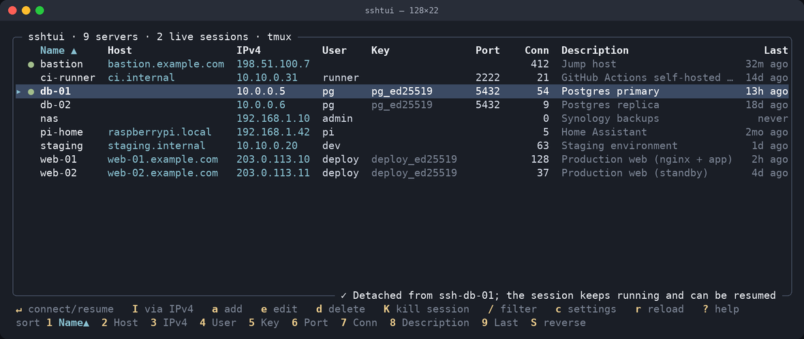

# shh

___

*note: the whole repository content was completely AI-generated, so feel free to reuse, fork, adapt, rebrand, open PRs and whatnot else.   
i couldnt mind less :)*

___

a little keyboard-driven terminal ui for your ssh servers. built with
[opentui](https://opentui.com) and bun; nothing fancy, it just gets you where you're going.

- **one yaml file** for everything: name, hostname, ipv4, user, key *path*,
  port, description, tags and a connection counter.
- **sortable table**: hit `1`–`9` to sort by a column (hit it again to flip it).
  `/` filters as you type; the hotkeys hang out at the bottom so you never have to remember them.
- **resumable sessions**: got tmux? cool, each server gets its own tmux session.
  detach, quit, close the terminal, whatever; enter picks it right back up later.
  live sessions get a little ●. no tmux? ssh just runs inline. no biggie.
- **new-window mode**: pop sessions open in your terminal emulator instead
  (still tmux-backed if it's around).
- **settings pane** for your defaults: user, key, port, launch mode, ssh options and so on.
- **your keys stay untouched**: shh only stores their paths and hands them to `ssh -i`.
- edits from the app **keep your yaml comments** right where you left them.



more pics: [filter & sort](docs/screenshots/02-sorted-filtered.png) ·
[edit form](docs/screenshots/03-edit-server.png) ·
[validation](docs/screenshots/04-add-validation.png) ·
[settings](docs/screenshots/05-settings.png) ·
[help](docs/screenshots/06-help.png) ·
[kill session](docs/screenshots/07-kill-confirm.png) ·
[narrow / inline](docs/screenshots/08-narrow-inline.png)

## quick start

```sh
# needs Bun ≥ 1.3.14 (https://bun.sh) and ssh; tmux recommended
bun install
bun run start            # first run creates ~/.config/shh/config.yaml
```

press `?` in the app if you forget a key. the full rundown lives in
**[docs/USER_GUIDE.md](docs/USER_GUIDE.md)**. curious why it's tmux and not
lockfiles? that's in [docs/DESIGN.md](docs/DESIGN.md).

## install as a command

```sh
bun link                 # runs from source; needs Bun
# or a standalone binary (build on the target OS/CPU):
bun run build && install -m 755 dist/shh ~/.local/bin/shh
```

## development

```sh
bun run dev        # watch mode
bun test           # unit + headless UI tests
bun run typecheck
bun run check      # both
```

every config option is in `config.example.yaml` if you wanna poke around.

license: mit
